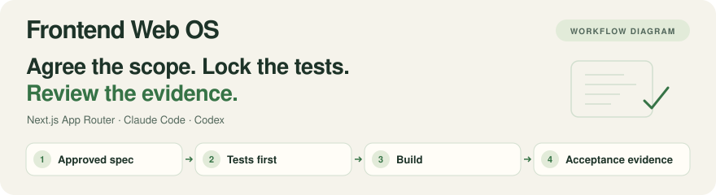
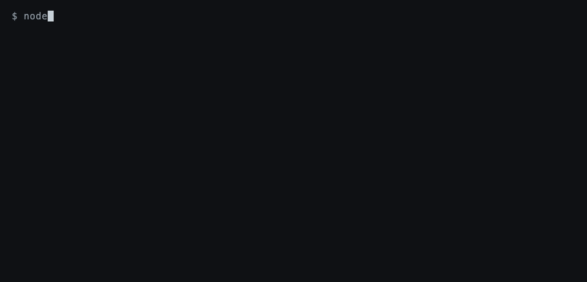
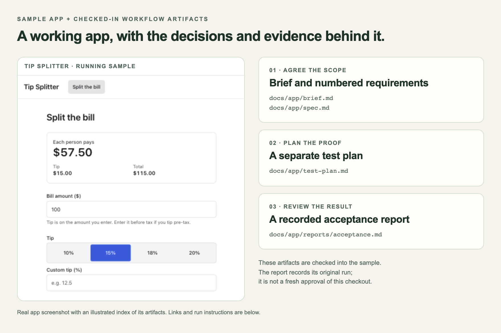

<picture>
  <source media="(prefers-color-scheme: dark)" srcset=".github/assets/banner-dark.svg">
  
</picture>



The CLI checks a synthetic example without model access. [Static output](#try-the-cli-without-model-access)
and [capture script](scripts/capture-demo.sh) show the same command and result.

[](LICENSE)


When an agent starts implementing a Next.js app before the requirements are settled, you can end
up reviewing code without agreed criteria for accepting it. Frontend Web OS (fwos), a plugin for
Claude Code and Codex, records those decisions, separates test planning from implementation and
produces an acceptance report from tagged test results and named sign-offs.

Next.js App Router with Tailwind 4 supports the full workflow. Pages Router or Tailwind 3 has
partial coverage. Adoption refuses unsupported stacks such as plain Node.js/HTML or Vite without
writing files.



The checked-in [Tip Splitter sample](demo/tip-splitter/), with its
[spec](demo/tip-splitter/docs/app/spec.md), [test plan](demo/tip-splitter/docs/app/test-plan.md)
and [historical acceptance report](demo/tip-splitter/docs/app/reports/acceptance.md).
The image combines the real running app with an illustrated index of those files.
The report describes its original recorded run, not a fresh approval of this checkout.

- **[Agree before building](docs/guide.md#start-an-app):** review the brief, spec and test plan before feature code.
- **[Keep the tests independent](#what-it-does):** separate test planning from implementation and
  lock tests by hash before the builder starts.
- **[Review the evidence](docs/guide.md#change-an-app):** inspect current recorded test results, browser evidence
  and named sign-offs in the acceptance report.

| Your project | Support | Starting point |
|---|---|---|
| New app | Next.js App Router with Tailwind CSS 4 | `/fwos:start` in an empty folder |
| Existing Next.js App Router app | Adoption preview, then checks, design or delivery | `/fwos:adopt` |
| Next.js Pages Router or Tailwind CSS 3 | Partial coverage, with unavailable checks listed | `fwos adopt` previews the limits |
| Node.js with plain HTML, Vite, or another framework | Unsupported by adoption; no files written | Keep your existing tooling |

[Adoption levels and prerequisites](docs/guide.md#use-fwos-in-an-existing-product) explain how to start with an
existing app. Individual source checks can run elsewhere, but OFF never proves stack support.

## Quick start

Frontend Web OS is distributed through the GitHub plugin marketplace. The CLI is bundled
with the plugin and copied into generated apps, so installation needs no fwos package on npm.

The [tip-splitter app](demo/tip-splitter/) is a complete sample with its spec and test plan.

For the agent workflow, supply a configured Claude Code 2.1.278+ or Codex CLI 0.155+ session with
model access, Node.js 22+, pnpm 10 and git 2.40+ on macOS or Linux. Windows is untested.

In Claude Code, the builder and adjudicator use Opus. In Codex they use your session's model.
App dependencies may require a newer Node patch version, as each sample's README explains.

fwos supplies the CLI and prompts. It asks before installing app dependencies or downloading
Playwright's Chromium (about 150 MB).

Install the plugin from inside Claude Code:

```
/plugin marketplace add tetriz-ai/frontend-web-os
/plugin install fwos@frontend-web-os
```

Run `/fwos:doctor` to check the install. Then open Claude Code in an empty folder and describe your
app. fwos asks before creating its project files.

```
/fwos:start "a personal reading list that works offline"
```

The first reviewable result is `docs/app/brief.md`, with the first-release jobs and explicit
assumptions. Compare the checked-in [reading-list brief](examples/reading-list/docs/app/brief.md),
then approve or correct your generated brief.

To resume later, open the same folder and invoke `/fwos:start` again.

In Codex, add the same marketplace and install the plugin, then trust fwos's hooks once in
`/hooks`:

```sh
codex plugin marketplace add tetriz-ai/frontend-web-os
codex plugin add fwos@frontend-web-os
```

Then open Codex in an empty folder and ask for the skill by name:

```
Use fwos:start for "a personal reading list that works offline"
```

[Codex setup and limitations](#in-codex) also apply.

### Try the CLI without model access

These bundled examples need only Node.js 22+, with no model session, plugin installation or
dependency install. Clone the repository for the CLI-only path:

```sh
git clone https://github.com/tetriz-ai/frontend-web-os.git
cd frontend-web-os
```

Then, from its root, run the checks on two examples. The first is an app at acceptance, with three
requirements and explicitly synthetic results plus a matching synthetic run record. They demonstrate
the checker without claiming a real test execution.

Both examples intentionally fail and exit 1:

```sh
node plugin/dist/fwos.mjs check tests/traceability --dir examples/prove-every-requirement/project
```

```text
PASS  state/schema
OFF   design-system/schema  no design-system/design-system.json yet; the design-system step writes it
FAIL  tests/traceability    2 findings
      AC-list-2: failing (expected the link under Read, found it under Unread)
      AC-list-3: no test ran (tag a test @AC-list-3)

1 pass, 1 fail, 1 off  NOT VERIFIED
```

The second is a component that uses raw colours and sizes where design tokens belong:

```sh
node plugin/dist/fwos.mjs check design-system/tokens --dir examples/catch-raw-design-values/project
```

```text
OFF   state/schema          not an fwos project (no .fwos/state.json); run /fwos:start
OFF   design-system/schema  no design-system/design-system.json yet; the design-system step writes it
FAIL  design-system/tokens  4 findings
      apps/web/src/features/list/row.tsx:3  "bg-white" uses Tailwind's default palette; use a slot colour (bg-surface, text-fg, bg-brand, text-critical...)
      apps/web/src/features/list/row.tsx:3  "text-[#1f2937]" hard-codes a colour; use a slot colour class
      apps/web/src/features/list/row.tsx:3  "text-sm" is a raw font size; use a type role (text-body, text-label, text-heading...)
      apps/web/src/features/list/row.tsx:3  "rounded-xl" isn't on the radius ladder; use rounded-sm, rounded-md, rounded-lg or rounded-full

0 pass, 1 fail, 2 off  NOT VERIFIED
```

A slot is a named role in your design system, such as `bg-surface` or `text-fg`, so components
never hold a raw value.

<details>
<summary>Explore commands, usage and reference</summary>

- [What it does](#what-it-does) lists each command and what you get from it.
- [Quick start](#quick-start) installs the plugin and shows the checks working on two examples.
- [Choosing a command](#choosing-a-command) matches what you have to the command to use.
- [Command recipes](docs/guide.md#command-recipes) show each command at work.
- [Reference](#reference) lists the checks, the files fwos writes and how the CLI gets into your
  app.
- [Before you rely on it](#before-you-rely-on-it) says what the checks can miss and what they flag
  too often.
- [Project](#project) covers versions, tests, contributing, security and the license.

</details>

## What it does

Commands that start with `/fwos:` run inside Claude Code, and in Codex you ask for the skill by
name, such as `fwos:start`. Commands that start with `fwos` run in a terminal or CI, and in a clone
of this repo `node plugin/dist/fwos.mjs` is the same CLI.

- **`/fwos:start "<idea>"`** takes an idea through
  [8 steps](docs/guide.md#2-your-first-app-step-by-step), waiting for your approval after each.
  Every default it takes stays tagged `[ASSUMED]` until you confirm it.
- **`fwos check`** reports PASS, FAIL or OFF for design values, module walls, test evidence and
  locked tests. Passing tests count by their tags, so what they assert still needs review:
  [test evidence limits](docs/limitations.md#the-agents) apply. [Try two failing examples](#try-the-cli-without-model-access).
- **fwos's own end-to-end tests** check rendered page and component states, hover and click
  targets, and static-route visibility for declared roles and flags. They can catch stale error
  rows, misleading hit areas and pages shown to the wrong role even when your tagged tests pass.
  [Browser coverage limits](docs/limitations.md#the-checks) describe what they miss.
- **Edit hooks** check every edit in an fwos project that the agent makes with Claude Code's Write
  and Edit tools or Codex's `apply_patch`. They block feature code until you approve the spec and
  test plan, block edits to locked tests and to fwos's own records in `.fwos/`, and flag raw design
  values as the agent writes them. At
  setup fwos also offers a git commit hook that runs `fwos check --staged`.
- **`/fwos:change "<request>"`** sends a later request to the step it belongs to. A copy fix goes
  straight to the build, and a new feature starts with questions.
- **`/fwos:adopt`** brings fwos into a Next.js app it didn't create. It shows what it found and what
  it would change before it writes anything, and you pick a level: the checks, your own design
  system, or change delivery. [See how](docs/guide.md#use-fwos-in-an-existing-product).
- **`fwos ia diff`** shows what a change added, moved, hid or exposed in `ia.json`, the app's list
  of pages, per page, role and flag. It compares two versions of `ia.json`, not the app.
- **`fwos prototype`** checks a prototype bundle, one feature's handoff from any design tool: its
  visual artifact, a real-component companion, its state inventory, the build spec, the decision
  record and its intended `ia.json`. `promote` pins its committed inputs once nothing stops it, and
  `diff` compares its intended IA with the app's routes and with what runs of fwos's IA harness
  showed each role. [See how](docs/guide.md#promote-a-prototype).
- **`/fwos:status`** says where a project stands and which approvals went stale.
- **`/fwos:doctor`** lists missing tools and says why any check is off. `fwos doctor --start` also
  starts the app and renders a state fixture before it calls the browser checks active.
- **`fwos design-system init --from-shadcn <globals.css>`** imports theme colours, radius and fonts
  into W3C Design Tokens (DTCG) files. Its report and browser gallery support your decisions about
  differences and component replacements before fidelity approval. [Inspect the theme example](examples/import-a-shadcn-theme/).
- **`fwos tests unlock <file> --reason "<why>" --reviewer "<name>"`** lets a locked test change,
  and the acceptance report lists each unlock with its reason.
- **`fwos report`** writes the acceptance report from the evidence. It lists each requirement, its
  verdict and the test that proves it. [See one](examples/reading-list/docs/app/reports/acceptance.md).
- **`fwos signoff <AC-x-n|GAP-n> --by "<name>"`** records a person's sign-off for a manual check or
  a named gap that no test can cover, such as a screen-reader walkthrough, and the acceptance
  report lists it.
- **`/fwos:learn`** turns a correction you made twice into a lasting fix, such as a check rule in
  `design-system/rules.yaml`.
- **`/fwos:eject`** removes fwos and keeps your docs and code.

What it does not do:

- **Backends.** It offers an API contract with mocks, data saved on the device, or your existing API.
- **Phone, Electron and native Mac apps.** It builds a responsive or installable web app. Electron
  and Mac apps can be planned in the spec and test plan, not built.
- **Other stacks.** See the support table above for framework coverage; `fwos doctor` explains
  individual check coverage.
- **Deploying, signing or publishing.** It prepares the commands and hands them to you, and it never
  asks for secrets.

## Choosing a command

| You have | Use | Example |
|---|---|---|
| An idea and an empty folder | `/fwos:start "<idea>"` | [Start an app](docs/guide.md#start-an-app) |
| A first release and a new request | `/fwos:change "<request>"` | [Change an app](docs/guide.md#change-an-app) |
| A project to pick up again | `/fwos:status` | [See where a project stands](docs/guide.md#see-where-a-project-stands) |
| A check that says OFF | `/fwos:doctor` | [Find out why a check is off](docs/guide.md#find-out-why-a-check-is-off) |
| A design system of your own | `fwos design-system init` | [Bring your own design system](docs/guide.md#bring-your-own-design-system) |
| A CI pipeline | `fwos check` | [Gate CI on the checks](docs/guide.md#gate-ci-on-the-checks) |
| An existing app | `/fwos:adopt` | [Use fwos in an existing product](docs/guide.md#use-fwos-in-an-existing-product) |
| A design ready to hand off | `fwos prototype` | [Promote a prototype](docs/guide.md#promote-a-prototype) |
| A correction you made twice | `/fwos:learn` | [Make a correction stick](docs/guide.md#make-a-correction-stick) |
| A project you want fwos out of | `/fwos:eject` | [Remove fwos](docs/guide.md#remove-fwos) |

The plugin and CLI share the project's files. Keep the vendored CLI at the plugin's version with
`fwos update --yes` after reviewing the `fwos update` preview. `fwos doctor` reports when it is behind.

## Reference

Every command is in the [CLI reference](plugin/kernel/knowledge/cli.md), the [guide](docs/guide.md)
walks through a whole project, and [examples/README.md](examples/README.md) lists every example.

### Checks

| Check | Fails when |
|---|---|
| `architecture/walls` | an import crosses a module wall `modules.json` doesn't allow, reaches past a public entry, or resolves to no file or package |
| `design-system/tokens` | app code uses a raw colour, a default-palette class, or a raw font size, font or radius |
| `design-system/contrast` | a text colour is under 4.5:1 on its surface, in any mode |
| `tests/traceability` | a first-release requirement's test fails, or from the accept step on, no passing test for it ran |
| `tests/locked` | a locked test changed without a recorded unlock, or a lock the last commit holds was edited out of `.fwos/` |
| `screens/ia` | the app's routes and `ia.json`, the page list you approve at the screens step, disagree in either direction, a limited page has nothing guarding it, or a run of the app shows a role a page `ia.json` hides from it, or no link to a nav page. See [Roles and flags](docs/limitations.md#the-checks) |
| `screens/states` | a page state has no passing tagged test, or fwos's harness saw it render wrong, such as a loading state that isn't busy, an error that keeps the ready rows, or a row that paints on hover while a click only reaches its title |
| `web/security` | there's no Content-Security-Policy, or a secret could reach the browser |

All 24, with what each reads and when it is off, are in [docs/checks.md](docs/checks.md).
`state/schema` and `design-system/schema` are gates: when one fails, every other check reports
OFF. In spike mode (`fwos init --mode spike`), `fwos check` and `fwos report` run nothing, print
NOT VERIFIED (spike mode) and exit 1.

### Files in your project

| Path | Owner | Holds |
|---|---|---|
| `docs/app/` | you | The brief, spec, test plan, decisions, `ia.json`, `modules.json` and prototype bundles (`prototypes/<id>/`) |
| `design-system/` | you | Tokens, the component registry and rule overrides |
| `packages/tokens/generated/` | fwos, generated | CSS variables and the Tailwind theme |
| `.fwos/` | fwos | Change files, approvals, locked tests, slice manifests, promoted prototypes and local evidence |
| `apps/web/e2e/fwos-*.spec.ts` | fwos | fwos's own end-to-end tests: `fwos harness` restores them, and a run of an edited one doesn't count |

[File formats](docs/file-formats.md) defines these records and their ownership.

### Getting the CLI into your app

The scaffold pins a local CLI copy for reproducible installs. [Installation commands](docs/guide.md#use-fwos-in-an-existing-product)
cover other apps.

After a plugin update, `fwos update` previews the refresh and `fwos update --yes`
applies it with backups. `fwos vendor` refreshes only the copy, and `fwos doctor` reports when it is behind.

### In Codex

fwos writes its agents to `.codex/agents/fwos-*.toml` with this machine's plugin folder, so those
files are git-ignored. Run `fwos codex agents` on each machine and after a plugin update.
`fwos doctor` reports stale definitions.

Trust fwos's hooks once in `/hooks`. The test planner's tool isolation depends on that hook,
while other read-only agents can still read local files and execute shell commands. Before using
the Codex app, verify its hooks.

Installation and manifest loading were checked with Codex CLI
0.155.1 and 0.164.0, as [supported versions](docs/supported-versions.md) records.

Codex may require approval to write `.git/` or `.codex/`. Approve the specific setup command or
run it yourself. [Codex boundaries](docs/limitations.md#in-codex) explain the sandbox and hook limits.

## Before you rely on it

### The checks

Source scans cannot prove runtime behavior. Computed imports and values can escape source checks,
and spacing is reviewed rather than enforced. OFF does not fail a run: inspect `fwos doctor`
before treating a green CI job as evidence.

### Browser coverage

Browser checks cover declared fixtures and static routes. They do not prove sign-in, backend
access control, undeclared states or behavior at every breakpoint. Run your own journey tests
against the production artifact as well.

### The agents

Model reviews, approvals and tagged tests depend on the evidence supplied. The adjudicator
reviews a requirement's assertions, but its prompt-based verdict is not a deterministic gate.
Approvals record names and hashes without authenticating who said yes.

[Detailed coverage and trust limits](docs/limitations.md) explain the source scans, shell-hook
boundary, local evidence, gallery, prototypes and Codex behavior. [Limit tests](scripts/tests/limits.test.ts)
and [Codex validation](#tests) document their evidence.

## Project

### Versioning and compatibility

GitHub hosts the plugin and release artifacts. fwos follows semantic versioning.
The `fwos-check` package is installed from a local copy or a GitHub archive, with no registry release.

Before 1.0, a minor release may change what a check catches, a
file format or a command's output, and the [changelog](CHANGELOG.md) says so.

[Quick start](#quick-start) names the versions it needs. Every supported version, and the package
ranges the web scaffold pins, are in [docs/supported-versions.md](docs/supported-versions.md).

Every file fwos reads names the schema it was written against, and a file from a schema this fwos
doesn't read stops `fwos check` before any check runs. After a plugin update, `fwos update` previews
what it would migrate from an older schema and refresh in `.fwos/cli/`, and `--yes` does it after
backing up each file it touches, unless a file in `.fwos/cli/` was edited since fwos wrote it. No
file has an older schema yet, so no migration has run on a real one, as
[File formats](docs/file-formats.md#versions-and-updates) explains.

The scaffold's package ranges and the tested Claude Code and Codex versions change together, in one
release, after `pnpm test:e2e` and `pnpm test:codex` pass on the new set. No response time is
promised for issues or pull requests. An archived release keeps working against the versions its
own `docs/supported-versions.md` lists.

### Tests

[CONTRIBUTING.md](CONTRIBUTING.md#run-the-checks) lists the development toolchain and validation
commands. The suite covers every module, each check against a good and a bad fixture, the CLI,
the hooks and the docs.

It also proves that every check
`fwos doctor` calls ON catches a violation planted for it, in the reading-list example and in both
surfaces of [a second pack](examples/second-pack/) that differs from it on every seam.

```sh
pnpm install --frozen-lockfile
pnpm test
```

`pnpm test` skips the scaffold, unrelated-app, gallery and live Codex tests, which need the network. `pnpm test:e2e` scaffolds
a real app and runs its whole suite against a production build, then plants each defect fwos's
harness claims to catch behind a passing test with the right name (the wrong state, stale rows on
error, a dead hit area, a page and nav link shown to the wrong role or flag, a nav page missing
from the nav) and shows each caught, then a clean control pass. It also adopts an unrelated
open-source app and runs the same planted-violation proof there, its components' rendered states
included, through the gallery.

`pnpm test:codex` installs the plugin into a throwaway Codex home and checks it in real Codex
sessions: the skills load, the session learns the plugin folder, a patch adding app source before
the spec is refused, and the test planner runs no tool. It needs a logged-in Codex CLI and spends
model usage. Run it separately from the offline checks.

### Contributing, security and license

- **Contributing:** see [CONTRIBUTING.md](CONTRIBUTING.md).
- **Security:** see [SECURITY.md](SECURITY.md).
- **Privacy:** [docs/privacy.md](docs/privacy.md) describes model access and confirms no fwos telemetry.
- **License:** MIT, see [LICENSE](LICENSE). The starter files fwos copies into your project keep
  their MIT header lines. Everything you build on them is yours.

Copyright 2026 Workloom Solutions Private Limited. Built by the [contributors](CONTRIBUTORS.md).
