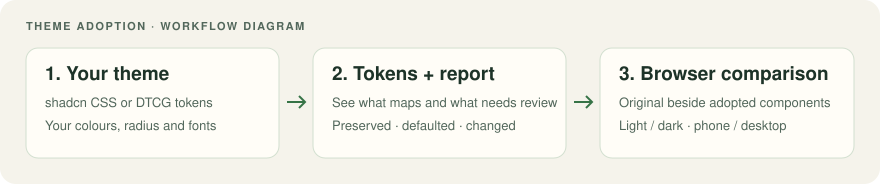

# The fwos guide

How to go from an idea to a tested web app with Frontend Web OS, step by step. Read the
[README](../README.md) first for the one-minute version.

- [1. Before you start](#1-before-you-start)
- [2. Your first app, step by step](#2-your-first-app-step-by-step)
- [3. After the first release: changes](#3-after-the-first-release-changes)
- [4. Bring your own design system](#4-bring-your-own-design-system)
- [5. Tests and evidence](#5-tests-and-evidence)
- [6. CI](#6-ci)
- [7. When something blocks you](#7-when-something-blocks-you)
- [8. The files in your project](#8-the-files-in-your-project)
- [9. Removing fwos](#9-removing-fwos)
- [10. FAQ](#10-faq)
- [Command recipes](#command-recipes)

## 1. Before you start

**You need:** a configured Claude Code 2.1.278+ or Codex CLI 0.155+ session with model access,
Node.js 22+, pnpm 10 and git, on macOS or Linux. Playwright's Chromium goes into your user cache
(`~/Library/Caches/ms-playwright` on macOS) the first time, after fwos asks.

**Install the plugin:**

Install the plugin as the README's [Quick start](../README.md#quick-start) shows.

```bash
claude plugin install fwos@frontend-web-os
```

Third-party plugins don't auto-update by default. Update with `claude plugin update fwos`. In
Codex, install it as the README's [quick start](../README.md#quick-start) shows, and read
[In Codex](../README.md#in-codex) for what differs there.

**Check your machine:** open Claude Code in any folder and run `/fwos:doctor`. It lists missing
tools with the exact fix. fwos never runs `sudo` or installs anything globally. It prints the
command for you.

**Two words to keep apart:**

| Word | Means |
|---|---|
| **Approval** | You said yes. fwos records it as a hash of what you approved, so any later edit makes it stale. |
| **Check** | `fwos check` said PASS, FAIL or OFF. Machine-only, never a model. |

## 2. Your first app, step by step

Make an empty folder, open Claude Code in it, and type your idea:

```
/fwos:start "a personal reading list that works offline on one device"
```

You can stop at any point. Next time, `/fwos:start` reads the files (never the chat history),
recaps where you were in 3 lines, and asks "still right?".

### Step 0: Start

fwos runs `doctor` quietly and tells you only what blocks a platform. Then it asks before each of
these, in one message: `git init`, creating `.fwos/` (`fwos init`), installing a git commit check,
and adding a permission allowlist so fwos commands don't prompt every time
([what it adds](permissions.md)).

### Step 1: Discovery

**What happens:** fwos interviews you one topic at a time: the problem, who it's for, the 3 jobs it
must do on day one, platforms, features, data, accounts, your design system, then offline,
integrations, constraints, privacy, accessibility, distribution, app identity and minimum versions.

**How to answer:** every question comes with a suggestion and the reason. Reply with one word to
take it, or your own take. Say "use your defaults" whenever you like. Each default is written
down as `[ASSUMED]` and stays visible until you confirm it.

**You approve:** `docs/app/brief.md`, starting with its 5-line "What you're approving" box.

> Want it fast? `/fwos:start --quick "<idea>"` asks only the 8 core topics and shows every
> assumption in one list. To replay a session, `/fwos:start --answers <file>` runs discovery from
> scripted answers and records each approval as autopilot, which the acceptance report flags.

### Step 2: Research

**What happens:** four research agents run in parallel, one each for the market, features,
feasibility and libraries. fwos shows the count and a rough cost first. Every finding has a source and a date, or says
`[UNVERIFIED]`. Every library is checked live against the npm registry before it's suggested.

**You decide:** whether to continue if something free already does this, and which suggested
additions to take. Research suggests and you pick. The brief is updated, so you approve it again.

Skip it with `--no-research`, or by saying so. The skip is logged.

### Step 3: Architecture

**What happens:** fwos asks about your stack, with defaults explained as consequences ("you can add
a desktop app later without a rewrite"): Next.js, Tailwind v4, TanStack Query, Vitest, Playwright,
one pnpm workspace. It plans a modular monolith: one folder per feature, each with one public
`index.ts`, and a list of who may depend on whom.

**What it writes:** `docs/app/modules.json` (the walls `fwos check` enforces),
`packages/api-contract/openapi.yaml` with JSON fixtures if the app has data, and rows in
`docs/app/decisions.md`.

**About backends:** fwos doesn't build one. You pick local mode (data saved on the device),
mock mode (a generated fake API), or your existing API or hosted backend.

### Step 4: Design system

**What happens:** you bring yours, or take the neutral starter (light and dark, passing contrast).

| You have | fwos runs |
|---|---|
| A shadcn or tweakcn theme | `fwos design-system init --from-shadcn path/to/globals.css` |
| DTCG tokens, Tokens Studio or Figma variables | the starter, then your token files replace its values, mapped slot by slot |
| Nothing | `fwos design-system init` |

fwos checks every slot and measures text contrast in every mode. When a colour fails, it suggests
the nearest passing shade and you decide. Then `fwos tokens build` generates the CSS variables and
a Tailwind theme that exposes only your slots, as [section 4](#4-bring-your-own-design-system) shows.

From a shadcn theme or your own tokens, `fwos design-system report` writes
`docs/app/reports/design-system.md`: where each slot's value came from (preserved, approximated,
defaulted, unsupported or changed), what the source had that nothing took, and each component with
what it becomes. Its outcomes stay apart: a schema and contrast PASS means valid and readable, not a
match with your old design. Read the report before you approve.

### Step 5: Screens

**What happens first:** the walking skeleton. fwos scaffolds the app, installs it (after asking),
and proves the toolchain: typecheck, component tests, Playwright default rows against a production
build, and `fwos check`. All green before any feature exists.

**Then the screens:** every key screen, built from registered components on fake data, in every
state: empty, filtered-empty, loading, error, offline, no permission. Open
`http://localhost:3000/fwos-screens` (`pnpm dev`) and click through each screen's states, and each
registered component's. Ask for changes as often as you like, because changes cost least here.
Each page calls `guardPage('<id>')` with its ID from `ia.json`, which lets in only the roles and
flag setting `ia.json` shows it to.

**With a design system you brought:** `fwos design-system gallery` renders each component with
your source's values and with the adopted tokens, side by side, and its Playwright run compares
them in both modes at phone and desktop width. You decide each difference, then
`fwos approve fidelity` records that you compared them, as [section 4](#4-bring-your-own-design-system)
says.

**You approve:** the screens and `docs/app/ia.json`, the list of every page, its route, who sees
it and the states it must show.

### Step 6: Spec and test plan

**What happens:** fwos writes `docs/app/spec.md`: journeys, screens, states, data, architecture and
numbered acceptance criteria (`AC-reading-1`, `AC-reading-2`...), each checkable without
interpretation ("the first screen shows within 1 second", never "feels fast"). It asks you only
the real forks. A separate reviewer agent cold-reads it. After two rounds, unresolved findings
may reach you for an explicit exception, recorded per finding in `decisions.md`.

Then the test-planner agent writes `docs/app/test-plan.md` from the spec alone. It never sees any
code. The plan has a case per requirement at the cheapest test level that proves it, the six
default rows every app gets, manual checks with reasons and named gaps.

**You approve both together.** Until then, the edit hook keeps feature code closed: only docs,
the design system, the contract and the screens paths can change.

### Step 7: Build

Slice by slice, in the spec's order:

1. The test-writer agent writes the slice's tests from the plan. Tests for new behaviour must fail
   first, and fwos keeps that red run as evidence.
2. fwos locks those test files by hash. The builder can't edit them, and `fwos check` fails if
   they change by any means.
3. The builder agent writes the code, using only registered components and design-system slots.
4. `fwos check` passes, and the builder checks the slice in a real browser (both themes, the
   console, hit targets). That browser pass is the agent following fwos's prompts, and fwos keeps
   no record of it.
5. fwos commits the slice with a manifest of what it built, after you say OK.

A behaviour change outside the slice becomes its own change request.

### Step 8: Accept

fwos runs the full suite through `fwos tests run` against a production build, then `fwos report` writes
`docs/app/reports/acceptance.md` from the evidence: every requirement with its verdict and the test
that proves it, every check that was off and why, every assumption, skip and override, and anything
waiting for a named sign-off. The adjudicator agent defaults to "fail" and tries to refute every
pass. Reviewers look at the full diff through 5 lenses: states, interaction, accessibility, visual
and copy.

**"Done"** means every first-release requirement passes with evidence, none rests only on a flaky
test, and every manual check and named gap is signed off by a person.

**You approve:** the acceptance report. fwos then prepares a release checklist. It never deploys,
signs or submits. It hands you the commands.

## 3. After the first release: changes

Any new request is a change: `/fwos:change "add a search box"`, or just type it after acceptance.
fwos classifies it and re-enters at the right step:

| Route | Example | Re-enters at |
|---|---|---|
| code-only | copy, spacing | build |
| touches-ac | a new filter on a list | spec |
| new-feature | "add sharing" | discovery |
| data-change | a new field on a saved item | spec, plus a migration and a test on old data |
| design-system | a new brand colour, a renamed token | design system |
| add-platform | "now a Mac app too" | architecture |
| architecture | "switch to micro-frontends" | architecture |

Each change gets its own file in `.fwos/changes/` (and its own branch if you like), so two people
on two branches never fight over one state file. Approvals carry over while the files they cover
haven't changed.

**Hand edits** are fine. If you edit the brief or the spec yourself, its approval turns stale on the
next command, and fwos asks whether to re-approve it or route it as a change.

## 4. Bring your own design system

fwos ships a contract of slots: named roles such as the page surface, body text or the brand
colour. The values are yours, and [the slot table](../plugin/modules/design-system/knowledge/slots.md)
lists every slot.

- **Your token names can differ.** Map them in `design-system/design-system.json`:
  `"slots": { "surface.base": "color.canvas.default" }`. The
  [Ember example](../examples/swap-in-a-design-system/ember) does exactly that.
- **Blank means off.** Leave the chart palette empty and the chart check turns off, and `doctor`
  says so. Required slots must be filled.
- **Components never change** when you swap design systems: they use slot classes (`bg-surface`,
  `text-fg`, `bg-brand`, `text-body`, `rounded-md`), and only the generated variables behind them
  change. The Tailwind theme clears the default palette, so `bg-red-500` doesn't exist.
- **Change a value:** edit `design-system/tokens/*.json`, then `fwos tokens build`. Never edit
  `packages/tokens/generated/`, because `fwos check` fails on a hand edit.
- **See where it came from.** `fwos design-system report` maps each slot to the file and key it
  reads, with the original and the resulting value in each mode, lists what the source had that
  nothing took, and reads each component's variants, states and interactions from its source.
- **Compare it rendered.** Once the app is scaffolded, `fwos design-system gallery` writes a
  dev-only page at `/fwos-screens/fwos-gallery` and a Playwright run. The run renders every
  variant and state twice, with your source's values and with the tokens fwos holds, and compares
  computed styles and interactions. Each difference names the token behind it, and the
  [import example's sample](../examples/import-a-shadcn-theme/gallery/report.md) shows what it finds.
- **Decide, then approve.** Every row and component that isn't preserved needs your decision:
  `fwos design-system decide <item> --as replace|omit|intentional --reason "<why>" --by "<name>"`.
  Then `fwos approve fidelity --by "<name>"` records that you compared the rendered result, apart
  from the design-system approval, and any later change makes it stale.

## 5. Tests and evidence

| You'll see | Means |
|---|---|
| `@AC-reading-3` in a test name | This test is written to prove requirement AC-reading-3 |
| `@state:list:empty` | This test is written to render the list page's empty state |
| `@TC-default-a11y` | One of the six default rows |

Results land in `.fwos/local/results/*.xml` (JUnit, written by Vitest and Playwright). At acceptance,
run `fwos tests run` to bind results to current application/test inputs and exact produced bytes;
unbound or edited XML does not count. The checker reads tags rather than assertions, so an agent
reviews the requirements' tests at acceptance; state-test intent remains a review responsibility.


**fwos's own tests.** `pnpm e2e` also runs `e2e/fwos-states.spec.ts` and `e2e/fwos-ia.spec.ts`,
which fwos writes and you don't edit. The first renders every page and component state in the
screens browser and judges what renders by the state's name: a loading state is busy, an error
announces itself and keeps none of the ready rows, an empty state says so. The second opens every
route as each role and flag setting in `ia.json` (through a test cookie the app honours only while
`FWOS_TEST_ACCESS=1`) and reads the nav. Their runs land in `.fwos/local/runs/`, tied to the code
they ran on, so `screens/states`, `design-system/required-states` and `screens/ia` need a run since
your last edit. `fwos harness status` says which runs still count.

**Locked tests.** If a locked test is genuinely wrong (the requirement changed), record why and who
agreed, then edit it and lock it again:

```bash
fwos tests unlock apps/web/e2e/list.spec.ts --reason "AC-reading-4 now allows empty titles" --reviewer "Ada"
```

The acceptance report lists every unlock.

**Flaky tests** (failed, then passed on retry) go in `.fwos/quarantine.json` with an expiry date.
A quarantined test never proves a requirement.

**Manual checks and gaps** need a person's name:

```bash
fwos signoff AC-reading-9 --by "Ada" --note "walked it with VoiceOver"
```

## 6. CI

The scaffold writes `.github/workflows/fwos.yml`: install, typecheck, unit tests, Playwright
against a production build, then `pnpm exec fwos check`. It uses the copy of the CLI the scaffold
vendored into `.fwos/cli/` (pinned in your `package.json` as `file:.fwos/cli`), which is the same
file the plugin runs. `fwos vendor` refreshes the copy after a plugin update (it touches nothing else), and
`fwos doctor` says when it's behind. No model calls, no secrets needed.

For the commit check outside Claude Code, run `fwos git-hook install`. With husky or lefthook, it
tells you the line to add instead.

## 7. When something blocks you

| You see | Why | What to do |
|---|---|---|
| `fwos [state/spec-gate]: ... is app source, and the spec and test plan aren't approved yet` | Feature code waits for an approved spec | Finish step 6, or put throwaway work in `spikes/` (`fwos spike new <name>`) |
| `fwos [tests/locked]: ... is a locked test` | Tests are locked so they can't be bent to pass | Change the code, or unlock with a reason and a reviewer |
| `brief changed after it was approved` | Someone edited an approved doc | Re-approve it, or route the edit as a change |
| A check says `OFF` | It can't run yet, and says why | Usually a later step; `fwos doctor` explains each one |
| `stopped: state/schema failed` | A file in `.fwos/` is malformed, or a file in `.fwos/`, `design-system/` or `docs/app/` (`ia.json`, `modules.json`) names a schema this fwos doesn't read | Fix the file it names; nothing else runs until then (fail closed). For an older schema, `fwos update` migrates it or says what to change |
| `design-system/tokens` fails | Raw colour, palette class or raw size in app code | Use a slot class; the message names it |
| `NOT VERIFIED` | At least one check failed | Read the FAIL lines; each names the file, line and fix |
| e2e tests hit the wrong app | Something else uses the port | They use their own port, 3210 (`E2E_PORT` changes it) |

## 8. The files in your project

```
docs/app/                yours: brief, research, spec, test plan, decisions, ia.json, modules.json
docs/app/reports/        generated: the acceptance report
design-system/           yours: tokens, components.json, rules.yaml, voice.md
packages/api-contract/   yours: openapi.yaml and fixtures (generated/ is generated)
packages/tokens/generated/  generated: CSS variables and the Tailwind theme
apps/web/                yours: the app
apps/web/e2e/fwos-*.spec.ts  fwos: its own end-to-end tests (`fwos harness` restores them)
.fwos/                   fwos: state, change files, approvals, locked tests, slice manifests
.fwos/local/             fwos, gitignored: test results, harness runs, logs, evidence
spikes/                  yours: throwaway code nothing may import
```

- **Yours:** fwos never overwrites it. It refuses, and tells you.
- **Generated:** rebuilt from your files. A hand edit fails `fwos check` (`state/owned`).
- **fwos:** state fwos updates. Commit it, because that's how approvals travel with your branch.

## 9. Removing fwos

`/fwos:eject` shows exactly what goes (`.fwos/` with the CLI copy in `.fwos/cli/`, the commit hook,
recognized historical fwos permission prefixes, the `fwos-check` pin, the `check` and
`tokens` scripts and CI step that run fwos, and the JUnit reporters that write test results to
`.fwos/local/results/`) and asks first. Vitest and Playwright keep their console reporters. A
script, CI or reporter line you changed or added stays, and so does a permission entry you wrote
that names fwos, including exact-command entries suggested at setup. Eject lists them as still
using fwos so you can review and remove unwanted entries yourself. While a line it leaves, or a test config of
your own, still sends results to `.fwos/local/`, the `.gitignore` lines for that folder stay too,
so those results stay out of git. Once the pin is gone, run `pnpm install` and commit
`pnpm-lock.yaml`: CI installs with a frozen lockfile, which fails while it still lists
`fwos-check`. Your docs, design system, code, tests and the rest of your CI workflow stay, and so
do the allowlist's `pnpm` and `git` entries. Uninstall the plugin with
`claude plugin uninstall fwos`.

## 10. FAQ

**Does fwos send my code anywhere?** Only to the model you already use with Claude Code or Codex,
and to web search during research (which you can turn off). No telemetry, no servers of its own.
See [privacy](privacy.md).

**Can I use it on an existing app?** `/fwos:start` starts from an empty folder. For a Next.js app
fwos didn't create, `/fwos:adopt` (or `fwos adopt` in a terminal) reads the repo and shows what it
found and what it would add, before it writes anything. You pick a level: `checks` makes
`fwos check` fail only on new findings, `design` imports your own theme as tokens, and `delivery`
lets `/fwos:change` deliver a request with a spec and test delta, in place: mapped onto the code it
touches (`fwos change map`), tested with your own scripts (`fwos tests run`), seen in a real browser,
with the tests around it run as regression evidence and each approval taken from your review as it's
given. Each level includes the ones before it, and `fwos adopt --level <level>` changes it later
without losing a record. The
[Use fwos in an existing product](#use-fwos-in-an-existing-product) has the
commands and the limits.

**Can I skip steps?** Research, architecture, design system and screens can be skipped with a
logged reason, and defaults apply. The brief, the spec with its test plan, and acceptance can't.
Spike mode has no approvals at all, and nothing may import a spike.

**Does it build a Mac or Electron app?** No. You can plan one in the spec and test plan, and
`fwos doctor` shows each platform's status.

**What does it cost?** fwos tells you the agent count and a rough cost before research and before
the build, and you can set a budget. `/fwos:status` shows spend per step when it's recorded.

**Is the edit hook a security boundary?** No, it's a guardrail. A shell command can write past it.
The commit check and CI (`fwos check`) are the backstop.

## Command recipes

In an app `/fwos:start` made, `pnpm exec fwos` works as is. Any other app gets its own copy from a
clone of this repository, as [Use fwos in an existing product](#use-fwos-in-an-existing-product)
shows. The local package does not require an npm registry release.

### Start an app

**When:** you have an idea and an empty folder.

```
/fwos:start --quick "a personal reading list that works offline"
```

`--quick` asks only the 8 core topics. Answer each, or say "use your defaults". fwos writes
`docs/app/brief.md`, asks you to approve it, and moves on one step at a time.

The steps are discovery, research, architecture, design system, screens, spec and test plan, build
in slices, and acceptance. [The walkthrough](#2-your-first-app-step-by-step) walks through
all 8, and the sample app in [examples/reading-list](../examples/reading-list/) went through every
step except research, which it skipped with a logged reason. Its
[acceptance report](../examples/reading-list/docs/app/reports/acceptance.md) lists each of its 10
first-release requirements with the tests that prove it.

**Remember:**

- Research, architecture, the design system and screens can be skipped, and the skip is logged.
- Stop whenever you like. The next `/fwos:start` resumes from the files, not the chat.
- `/fwos:start --answers <file>` runs discovery from scripted answers and records each approval as
  autopilot, which the acceptance report flags.

### Use fwos in an existing product

**When:** you have a Next.js app fwos didn't create, and you want its checks, its design review or
its change delivery without a rewrite.

```
/fwos:adopt
```

In Codex, ask for `fwos:adopt`. It reads the repo and lists what it found, each finding with the
file it came from, and what it looked for and didn't find. Then it proposes what fwos would reuse,
add and change at the level you pick, with the `.fwos/state.json` it would write and what its hooks
would do, before it writes anything.

From the existing app's root, with this repository cloned beside the app as `frontend-web-os`:

```sh
FWOS_REPO="$(cd ../frontend-web-os && pwd)"
node "$FWOS_REPO/plugin/dist/fwos.mjs" adopt
node "$FWOS_REPO/plugin/dist/fwos.mjs" adopt --yes
node "$FWOS_REPO/plugin/dist/fwos.mjs" vendor
pnpm add -D file:.fwos/cli
```

The first command writes nothing. The second writes `.fwos/` and one `.gitignore` line, and records
today's findings as the baseline, so `fwos check` fails only on new ones. The last two, which only
you run, copy the CLI into `.fwos/cli/` and add it to your devDependencies, so CI runs
`pnpm exec fwos check` with no clone.

Your package.json scripts, CI, git hooks, lint config, agent instructions and code stay as they are.
fwos only names the line to add when you want its check in CI or the commit hook. Commit `.fwos/`
with the rest of your code.

Each level includes the ones before it:

| Level | What fwos adds | Needs |
|---|---|---|
| `checks` | `fwos check` on your app, with today's findings recorded as debt | Next.js App Router for full coverage; Pages Router is partial |
| `design` | Your own theme as DTCG tokens, checked for contrast, your components in the registry, and on request the mapping report and the gallery that renders your components with your theme and with the tokens | Your shadcn theme, a CSS file with its variables |
| `delivery` | `/fwos:change` delivers a request in place, with a spec and test delta, the spec gate while a change is open, locked tests and an acceptance report | A test script in package.json, which `fwos tests run` runs with a JUnit reporter added |

`fwos adopt --level design` previews the next level, and adding `--yes` turns it on. It keeps every
record, and takes only the findings of the checks it turns on into the baseline. `fwos status` and
`fwos doctor` show each capability as ON or OFF, with what turns it on.

The proposal goes stage by stage too, from the idea to its acceptance: for idea, design, spec, test
planning, build and acceptance, what your repo shows you do today (with the file), what that leaves
open, what fwos adds and the evidence that would show it helped. A stage you already serve well can
stay yours: `fwos adopt --keep test-plan --reason "QA plans our tests in TestRail" --yes`. fwos then
adds nothing there, and each change links your own artifact for it with
`fwos change link <url|path> --stage test-plan`.

At level delivery, ask for a change in your words, or point at the issue or spec it comes from:

```
/fwos:change "add search and an empty state to the members table, from https://github.com/example/app/issues/12"
```

A change starts at its own spec, or at build for a code-only fix. `fwos change map /members`
records the affected page, components, data calls, tests and code owners.

The spec delta names those files and the criteria the change adds or changes. At least one
criterion needs browser evidence, unless the test plan explains a named `GAP-browser` sign-off.

Before anything is built, the spec delta traces the request: each ask with the criteria that
deliver it or why it was dropped, each question with its answer (the spec isn't approved while one
is open), and the states the change brings, such as the one where a search matches no one.
`fwos check` flags a criterion that needs interpretation ("relevant", "quickly") and a changed
criterion the test plan only covers with its old tests. At each step fwos says what is still open,
and `fwos change trace` shows the change from the request to each test that proves it.

`fwos tests run` runs your own test scripts as you do (`pnpm test`, `pnpm e2e`) and adds a JUnit
reporter on the command line, so Vitest, Playwright, Jest, Cypress and Mocha results count while
your configs stay as they are. A script fwos can't read results from still runs, and fwos says that
run proves nothing. fwos locks only the tests a change adds or changes, `tests/regression` fails
when a test the map found around it breaks, and `fwos change drift` flags an edit outside what it
maps.

fwos suggests a branch named the way yours are, and a reviewer's yes in your pull request is
recorded with its link (`fwos approve spec --by "<name>" --via pr --ref <review URL>`). The
acceptance report separates this change's approvals and new findings from its request, earlier
criteria, existing tests and baseline debt.

**Remember:**

- In a monorepo, `fwos adopt` lists every app and asks which one, as in `--app apps/site`. The other
  apps, and the packages only they use, are skipped by every check and never gated.
- When `docs/app/` or `design-system/` already holds your own files, it stops and asks for another
  folder (`--docs`, `--design-system`).
- See the support table above for framework coverage and partial-support cases.
- Gate failures, approvals that no longer hold, unproven requirements and changed locked tests are
  never baselined. A baseline widened by hand isn't honoured until it is committed, so review
  `.fwos/baseline.json` in pull requests.
- A change to the design system, the platforms or the architecture isn't delivered through fwos in
  an adopted app. Those stay your team's.
- fwos records an approval only on a change, when a person gives it. It records none for the brief,
  architecture, design system or screens your product already has. The fidelity approval is the
  exception, since it reviews fwos's import of your design system.
- Your app has no screens browser, so once `fwos design-system gallery` has run, a state you list
  for one of your components in `design-system/components.json` renders in the gallery. After
  installing the CLI as above, run `fwos harness`, and your Playwright run
  judges each of those states, as `fwos doctor --start` shows.
- `/fwos:eject` removes the fwos integration; your docs, design system, app code and tests stay.
  It lists modified integration lines and exact-command permission entries for manual removal.

### Change an app

**When:** the first release is accepted and you want something new.

```
/fwos:change "add a filter for unread links"
```

fwos names the route and waits for your yes. A filter changes the requirements of a feature you
already have, so the change re-enters at the spec.

**Remember:**

- Approvals carry over while the files they cover are unchanged.
- An edit you made by hand to an approved doc makes its approval stale, and fwos asks what to do.

### See where a project stands

**When:** you come back to a project, or a teammate hands one over.

```
/fwos:status
```

It shows the current change and step and the locked tests, and marks each approval approved,
stale, missing or skipped.

### Find out why a check is off

**When:** `fwos check` says OFF and you want to know what turns the check on.

```
/fwos:doctor
```

Doctor lists missing tools with the fix, each platform's status, and every check as on or off with
its reason. It reads only, so finding Playwright installed doesn't make the browser checks active.
For that, start the app:

```sh
pnpm exec fwos doctor --start
```

It runs your app's `next dev` with the screens browser on, renders a state fixture in Chromium,
opens `/` as a role, then stops the server. The verify row then says what rendered and which
defects fwos's harness can catch in your app, and names anything that didn't start or render.
`--url http://localhost:3000` uses an app you already started.

### Promote a prototype

**When:** a feature's design is settled and the app renders its screens from your components.

Put the bundle in `docs/app/prototypes/<id>/`: a `bundle.json` that links the visual artifact (an
HTML file, an image, a Figma or Storybook link, or a route), the screens browser route that renders
each page from registered components, a `states.md` with a line per state of each page, the spec
section, the decision record if there is one, and the `ia.json` the feature leaves the app with.
[File formats](file-formats.md#prototype-bundles) shows each.

```sh
pnpm exec fwos prototype check
pnpm exec fwos prototype promote members --by "Jane Doe"
pnpm exec fwos prototype diff members
```

`check` names what stops a promotion: a link into a `working/` draft, a role or flag your
`ia.json` lacks, a duplicate ID, a missing state, a page with no companion, or an app route the
bundle's IA doesn't classify. `promote` needs the bundle and what it links committed, and pins each
by hash, and an edit after that makes it stale. `diff` shows what the app still lacks, what moved, and
who sees what differently, from the last run of `pnpm e2e`.

### Bring your own design system

**When:** you already have a shadcn theme or design tokens.

```sh
pnpm exec fwos design-system init --from-shadcn app/globals.css
```

It writes DTCG tokens to `design-system/`, a copy of your theme to `design-system/source/`, and
`docs/app/reports/design-system.md`. That report maps every slot to the theme variable it came
from, with both values in each mode and whether it was preserved, approximated, defaulted,
unsupported or changed, then lists what nothing took and each component with what it becomes. Then
run `pnpm exec fwos tokens build`, which writes `packages/tokens/generated/` at the project root.



This diagram shows the workflow. Inspect the actual [comparison report](../examples/import-a-shadcn-theme/gallery/report.md)
and [browser sheet](../examples/import-a-shadcn-theme/gallery/light-desktop.jpg) for the rendered sample.

Replace the theme blocks in your `globals.css` with two imports of those files. Each path runs from
your `globals.css` to `packages/tokens/generated/`, so from `app/globals.css` they are:

```css
@import "../packages/tokens/generated/tokens.css";
@import "../packages/tokens/generated/theme.css";
```

**Remember:**

- Until you replace the theme blocks, `fwos check` flags the raw colours left in the old theme.
- Token names can differ from fwos's. Map them in `design-system/design-system.json`, as
  [the Ember example](../examples/swap-in-a-design-system/) does.
- It imports the theme, not your components: `components.json` starts as fwos's starter registry,
  and each starter component that stands in for one of yours needs your decision.
- Once the app is scaffolded, `pnpm exec fwos design-system gallery` writes a dev-only page and a
  Playwright run. It renders every variant and state of each component with your theme's values
  and with the tokens, in light and dark at phone and desktop width, then compares computed styles
  and interactions. The report names the token behind each difference.
- Five outcomes say different things. The screens preview shows the app on fake data, the schema
  and contrast checks say the tokens are valid and readable, and `design-system/generated` says
  the CSS matches the tokens. Adoption coverage counts what came across as it was, and only
  `fwos approve fidelity` records that a person compared the rendered result with your original.
- [The sample report and gallery](../examples/import-a-shadcn-theme/gallery/report.md) show what to
  inspect.

### Gate CI on the checks

**When:** you want a pull request to fail when the checks fail.

```yaml
- run: pnpm exec fwos check
```

The app `/fwos:start` scaffolds already has `.github/workflows/fwos.yml`, which runs the tests and
then this line. It needs no model and no secrets. The full workflow is
[fwos.yml](../plugin/modules/screens/templates/web/.github/workflows/fwos.yml).

**Remember:**

- Read [All OFF passes](../README.md#the-checks) before you trust a green job.
- Run `pnpm exec fwos tests run` in the same job before `pnpm exec fwos check`. This records the
  current application/test inputs and produced results. Running `pnpm test` directly or copying
  JUnit XML alone does not provide the current run record required for acceptance.

### Make a correction stick

**When:** you've corrected the agent on the same thing twice.

```
/fwos:learn
```

fwos proposes the lightest fix that will hold. That can be a code comment, a note for the code
reviewers, a line in `docs/app/decisions.md` or a check rule in `design-system/rules.yaml`. You
pick, and a new check rule is proven on its own bad and good examples.

### Remove fwos

**When:** you want fwos out of a project.

```
/fwos:eject
```

It removes `.fwos/`, the commit hook, recognized historical fwos permission prefixes, the
`fwos-check` pin to `.fwos/cli`, the `check` and `tokens` scripts and CI step the scaffold added to
run fwos, and the JUnit reporters it added to the test configs. It lists each one and asks first,
and keeps a line you changed or an exact-command permission entry, listing it as still using
fwos so you can review and remove it yourself.

Your docs, design system, code, tests and the rest of your CI workflow stay, and so do the
allowlist's `pnpm` and `git` entries, which you may still want.

A line in any other workflow that runs fwos, like the step from
[Gate CI on the checks](#gate-ci-on-the-checks), stays, and eject lists it. Take it out yourself,
since it fails once the pin is gone.
