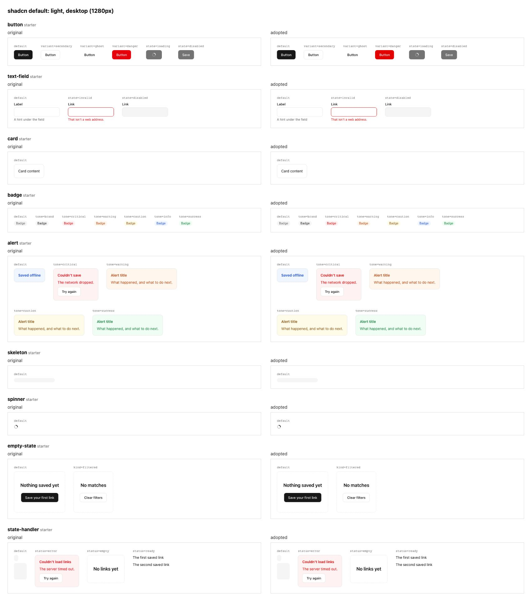

# Import a shadcn theme

A plain shadcn theme becomes DTCG tokens with one command. fwos keeps a copy of the theme and writes `docs/app/reports/design-system.md`, which says where every slot's value came from and lists the 4 theme variables no slot took, and it lists the guesses to confirm first, tagged `[ASSUMED]`. The contrast check then finds that the theme's default destructive red falls just under 4.5:1 on a light red background and suggests the nearest shade that passes, and `fwos design-system report` prints the outcomes that report keeps apart: a PASS from the schema and contrast checks is not a match with the theme.

```sh
examples/import-a-shadcn-theme/run.sh
```

```text
Wrote design-system/ (8 files, from globals.css). These files are yours.
Mapping report in docs/app/reports/design-system.md: 20 preserved, 5 approximated, 36 defaulted, 4 unsupported. A PASS from the design-system checks means valid and readable, not a match with your theme: `fwos design-system report` keeps the outcomes apart.
12 [ASSUMED] defaults to confirm:
  - surface.interactive: taken from --secondary (shadcn has no exact match)
  - text.secondary: taken from --muted-foreground (shadcn has no exact match)
  - text.inverted: taken from --primary-foreground (shadcn has no exact match)
  - border.faint: taken from --input (shadcn has no exact match)
  - state.hover: taken from --accent (shadcn has no exact match)
  - font.sans: no --font-sans in the theme; kept the neutral starter value
  - font.mono: no --font-mono in the theme; kept the neutral starter value
  - status.warning: shadcn has no warning colours; kept the neutral starter pair
  - status.caution: shadcn has no caution colours; kept the neutral starter pair
  - status.info: shadcn has no info colours; kept the neutral starter pair
  - status.success: shadcn has no success colours; kept the neutral starter pair
  - status.critical.bg: shadcn has no destructive background; kept the neutral starter value
PASS  state/schema
PASS  design-system/schema    shadcn default: modes light, dark; 12 [ASSUMED] defaults to confirm; imported from globals.css: valid, not shown to match it (`fwos design-system report` maps it)
FAIL  design-system/contrast  1 finding
      design-system  light: status.critical.text on status.critical.bg is 4.36:1, under 4.5:1; nearest passing shade #e20000

2 pass, 1 fail, 0 off  NOT VERIFIED
exit code: 1
Token validity     FAIL          design-system/schema PASS, design-system/contrast FAIL (1 finding), design-system/chart-palette FAIL (1 finding)
Generated CSS      not built     token CSS not generated yet (packages/tokens/generated/tokens.css, packages/tokens/generated/theme.css); run `fwos tokens build`
Adoption coverage  partial       slots: 20 preserved, 5 approximated, 36 defaulted; 4 source entries not consumed; components: 9 fwos starter
Fidelity           not compared  no rendered comparison yet: run `fwos design-system gallery`, then `pnpm --dir apps/web exec playwright test -c "app/(fwos-screens)/fwos-screens/fwos-gallery/playwright.config.ts"`. 54 items need a decision.
Preview            -             /fwos-screens shows the app on fake data. It compares nothing with your source.

Unchanged: docs/app/reports/design-system.md
```

## The gallery sample

[gallery/](gallery/) holds a real run of `fwos design-system gallery` on this theme, in an app `fwos scaffold web` made, with the contrast fix above applied (the light critical red set to `#e20000`) and recorded as intentional. [Its report](gallery/report.md) shows what a new adopter should inspect:

- each slot with its original and resulting value in both modes, and the 4 theme variables nothing took,
- fwos's nine starter components, each rendered with the theme's own values and with the tokens, in light and dark at 390 and 1280 pixels wide,
- the differences the fix makes, each traced to `status.critical.text`, apart from the cells that render the same,
- what still needs a decision before `fwos approve fidelity`.



The other sheets: [light, phone](gallery/light-phone.jpg), [dark, desktop](gallery/dark-desktop.jpg) and [dark, phone](gallery/dark-phone.jpg). [results.json](gallery/results.json) is the run's evidence and [decisions.json](gallery/decisions.json) its decision. `FWOS_E2E=1 FWOS_GALLERY_SAMPLES=1 pnpm vitest run scripts/tests/gallery.test.ts` writes the sample again (it needs the network and Chromium), and `scripts/tests/gallery-samples.test.ts` checks that this report is still the one fwos writes for that run.

The [source inputs](gallery/source-inputs.json) record the exact text/configuration and dependency lock used by the browser sample, with byte hashes and generator provenance. Snapshot generation rejects live env files and unsupported binary inputs. Sample decision names are synthetic test labels, not a human approval for your app.
