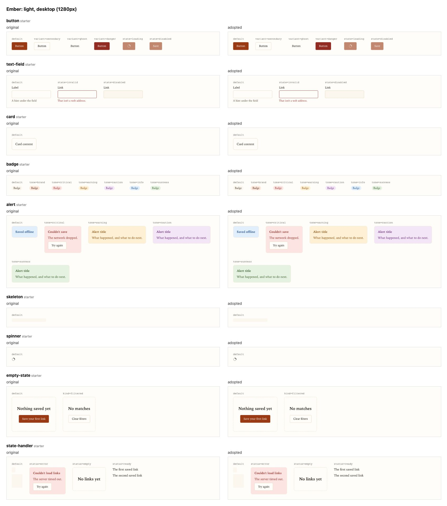

# Swap in a design system

Ember is a second design system whose token names differ from fwos's (`color.canvas.default`, `color.ink.strong`, `shape.corner.small`). Its `design-system.json` maps each fwos slot onto them, so the checks pass and the generated CSS variables carry Ember's values, while component code stays the same. `fwos design-system report` then says how much of Ember came across: 31 slots read Ember's own tokens, the rest are fwos's fallbacks, and 2 palette tokens reach no slot. Use this when you bring your own tokens.

```sh
examples/swap-in-a-design-system/run.sh
```

```text
PASS  state/schema
PASS  design-system/schema    Ember: modes light, dark; blank (their checks are off): chart.1, chart.2, chart.3, chart.4, chart.other
PASS  design-system/contrast  36 pairs measured
wrote packages/tokens/generated/tokens.css
wrote packages/tokens/generated/theme.css
  --ds-surface-base: #fffdf9;
  --ds-text-primary: #16110b;
  --ds-brand-primary: #9a3a15;
  --ds-font-sans: "Iowan Old Style", Charter, Georgia, serif;
Token validity     PASS          design-system/schema PASS, design-system/contrast PASS
Generated CSS      current       the CSS variables and the Tailwind theme match the tokens
Adoption coverage  partial       slots: 31 preserved, 30 defaulted; 2 source entries not consumed; components: 9 fwos starter
Fidelity           not compared  no rendered comparison yet: run `fwos design-system gallery`, then `pnpm --dir apps/web exec playwright test -c "app/(fwos-screens)/fwos-screens/fwos-gallery/playwright.config.ts"`. 41 items need a decision.
Preview            -             /fwos-screens shows the app on fake data. It compares nothing with your source.

Wrote docs/app/reports/design-system.md
```

## The gallery sample

[gallery/](gallery/) holds a real run of `fwos design-system gallery` with Ember swapped into an app `fwos scaffold web` made. Ember's token files are its source, so every cell renders the same on both sides: [the report](gallery/report.md) shows that, the slots fwos filled, the 2 palette tokens nothing reads, and the nine starter components that stand in for components Ember doesn't have, each waiting on a decision.



The other sheets: [light, phone](gallery/light-phone.jpg), [dark, desktop](gallery/dark-desktop.jpg) and [dark, phone](gallery/dark-phone.jpg). [results.json](gallery/results.json) is the run's evidence. `scripts/tests/gallery-samples.test.ts` checks that the report is still the one fwos writes for that run.

The [source inputs](gallery/source-inputs.json) record the exact text/configuration and dependency lock used by the browser sample, with byte hashes and generator provenance. Snapshot generation rejects live env files and unsupported binary inputs. Sample decision names are synthetic test labels, not a human approval for your app.
